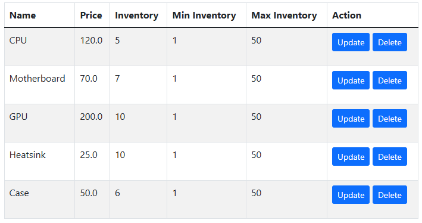
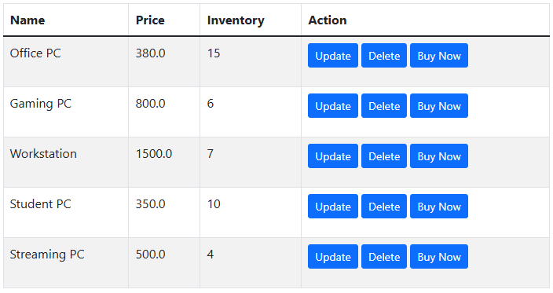

# Inventory System
## Project Overview
The Inventory System is a web-based application developed using the Java Spring Framework. It is designed to help businesses efficiently manage, monitor, and maintain inventory records for a wide variety of products and materials.

The system allows employees to add, update, search, and delete inventory items while maintaining accurate stock records. It also provides inventory validation, minimum and maximum stock level controls, and purchasing functionality to help businesses maintain appropriate inventory levels and manage product availability.

The application combines a Java-based backend with an HTML-based frontend to provide a user-friendly interface for managing inventory operations. This software supports some types of inventory management.

For example, this project was designed with computer parts and products in mind. A computer hardware retailer could use the system to manage individual components such as processors and associate them with assembled products such as desktop computers. Employees can monitor component availability, manage assembled products, maintain appropriate stock levels, and process product purchases.

## Technologies Used
- **Programming Language:** Java
- **Backend Framework:** Spring Framework, Spring Boot, Spring MVC
- **Frontend:** Thymeleaf, HTML, CSS
- **Database:** Spring Data JPA
- **Build Management:** Maven
- **Version Control:** GitHub
- **Development Environment:** IntelliJ IDEA

## Application Features
### 1. Parts Management
The application supports two types of computer hardware parts:
- **In-house Parts:** Computer components manufactured or assembled internally.
- **Outsourced Parts:** Computer components purchased from external suppliers.

Users can:

- View all available computer parts.
- Search parts by name.
- Add new parts.
- Update existing parts.
- Delete parts that are not associated with products.
- Monitor available inventory.
- Set minimum and maximum inventory thresholds.

### 2. Product Management
The application supports managing computer hardware products and assembled computer systems.

Users can:

- View available products.
- Search products by name.
- Add new products.
- Update existing products.
- Associate computer components with products.
- Delete products.
- Monitor product inventory.

Products use a set-based collection of associated parts to prevent duplicate part associations. When multiple identical components are needed, a multi-pack part can be created.

### 3. Inventory Management
Minimum and maximum inventory controls help maintain accurate computer hardware stock levels.

The application validates inventory when parts are added or updated.

Inventory controls include:

- Preventing inventory from falling below the minimum quantity.
- Preventing inventory from exceeding the maximum quantity.
- Validating component availability during product assembly.
- Preventing product assembly from reducing associated part inventory below minimum levels.
- Displaying validation messages when inventory requirements are not satisfied.

### 4. Buy Now Functionality
A Buy Now button is available alongside the product update and delete controls.

When a product is purchased:
- The selected product's inventory decreases by one.
- Associated computer part inventory remains unchanged.
- A success or failure message is displayed to communicate the purchase result.

This functionality simulates product sales while preserving accurate component inventory records.

### 5. About Page
The application includes an About page describing the computer hardware retailer and its business operations. Navigation links allow users to move between the main inventory screen and the About page.

### 6. Sample Inventory Initialization
The application initializes sample inventory consisting of five parts and five products.

Sample data is only added when both the parts list and products list are empty.

Existing inventory records are preserved, preventing sample data from overwriting previously stored information.

### 7. Database Persistence
The application uses Spring Data JPA for data persistence, ensuring inventory information is stored and retained.

The persistence configuration includes a customized storage filename to distinguish the application data from the original project configuration.

## Sample Inventory
The sample inventory represents common computer hardware components and computer products.
### Computer Parts

### Computer Products


## Installation and Setup
### Prerequisites
- Java Development Kit (JDK) 17 or compatible version.
- IntelliJ IDEA.
- Maven.
- Git.
- Access to the GitHub repository.

### Installation Instructions
- Clone the GitHub repository:
```
git clone https://github.com/NB700/Inventory-Tracking
```
- Open IntelliJ IDEA.
- Select **File → Open** and locate the cloned project directory.
- Allow IntelliJ IDEA to import the Maven project and download the required dependencies.
- Verify that the correct Java SDK is configured.
- Locate the Spring Boot application entry-point class.
- Run the application.

### Accessing the Application
After successfully starting the application, open a web browser and navigate to: http://localhost:8080/mainscreen

The main screen displays the computer parts and products available in the inventory.
